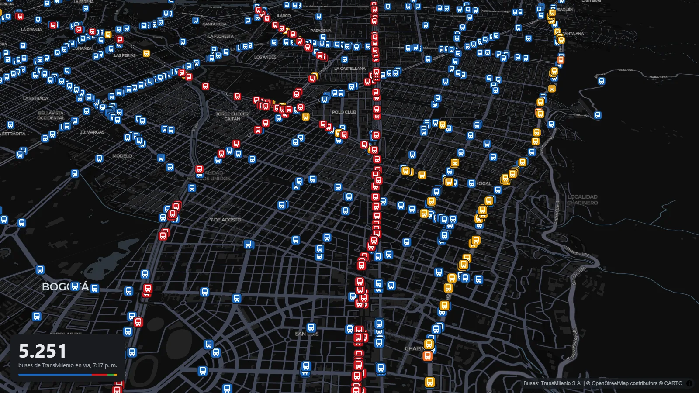
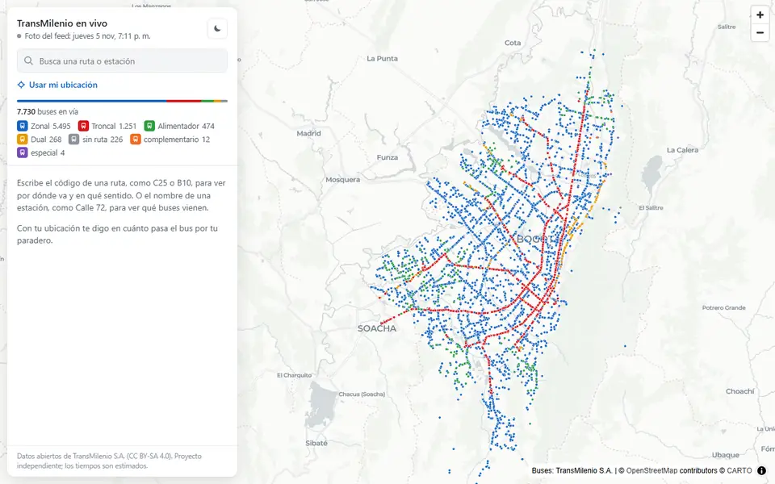
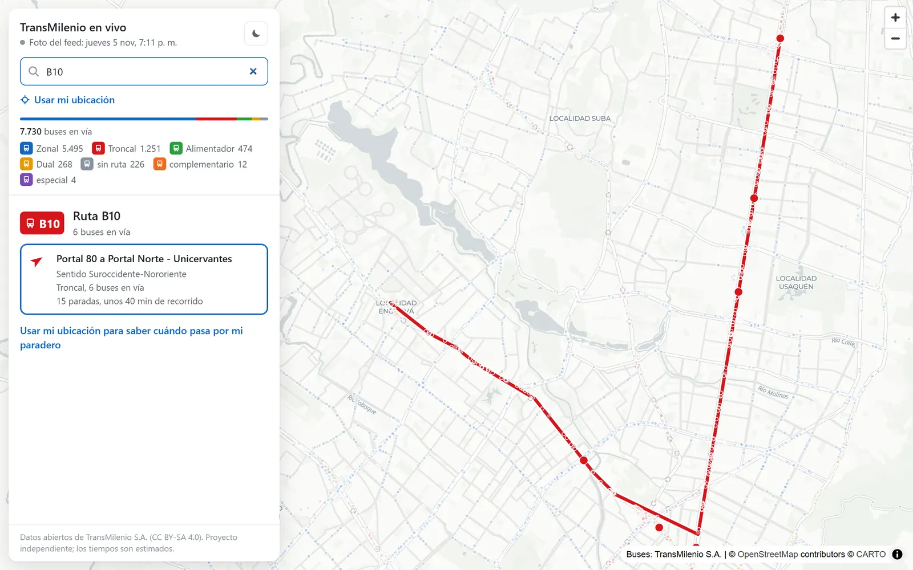
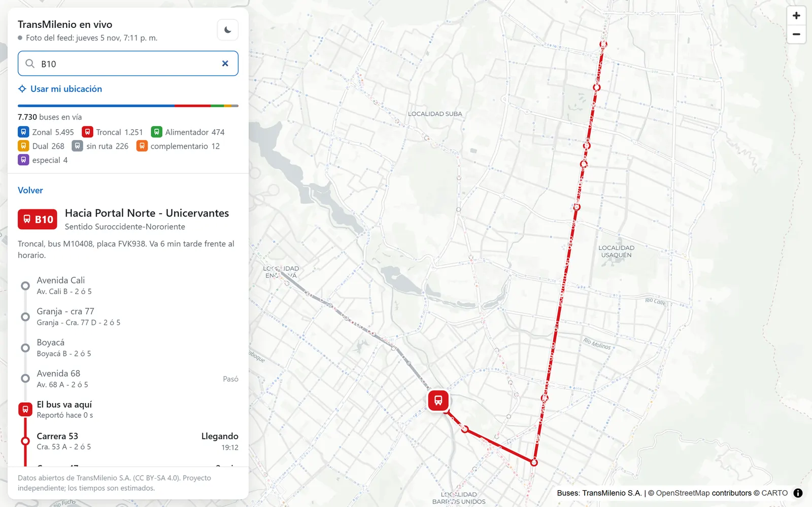
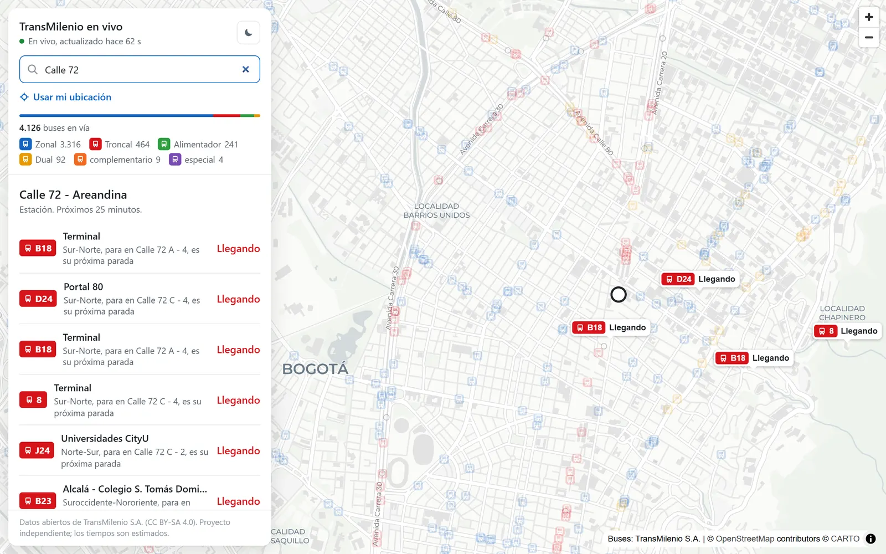
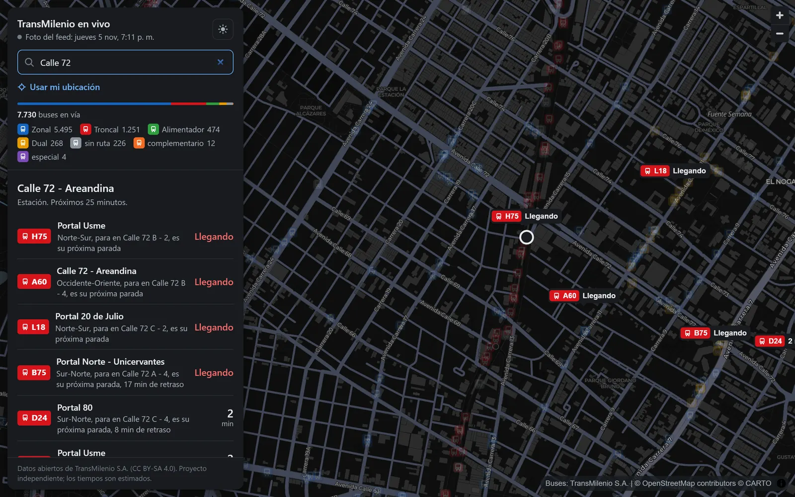
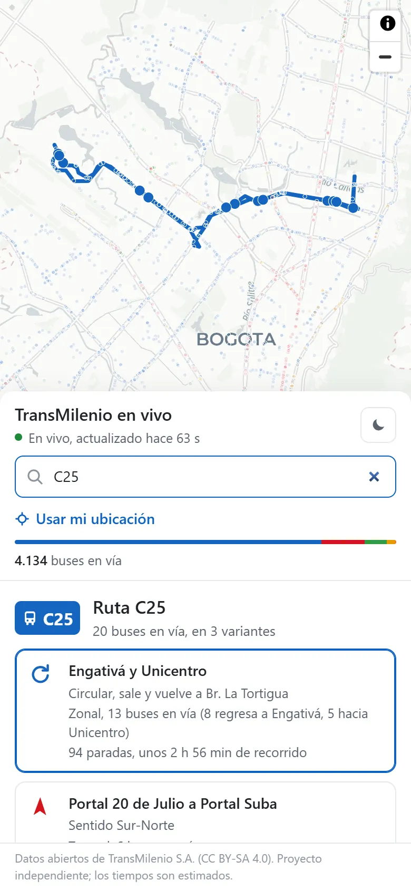

# transmilenio-mcp

[](https://github.com/prestrepo2312/transmilenio-mcp/actions/workflows/ci.yml)


Desde el 4 de noviembre de 2026 TransMilenio publica la posición de sus buses como datos
abiertos (GTFS Realtime). Este proyecto los conecta a Claude por MCP y trae un mapa para
verlos en el navegador. Corre en tu computador y no pide API key ni registro.



```
Tú:     ¿Qué buses llegan a Calle 72 en los próximos 5 minutos?
Claude: H75 hacia Portal Usme, llegando (vagón B-2). A60, llegando.
        L18 hacia Portal 20 de Julio, en 1 min. D24 hacia Portal 80, en 2 min (va 8 min tarde).
```

Cubre troncales, duales, alimentadores, SITP zonal y TransMiCable. El 5 de noviembre a las
7 p. m. el feed tenía 7.730 buses en 665 rutas.

## Instalar

Hace falta [uv](https://docs.astral.sh/uv/) (`pip install uv`).

**Claude Code**

```bash
claude mcp add transmilenio -- uvx --from git+https://github.com/prestrepo2312/transmilenio-mcp transmilenio-mcp
```

**Claude Desktop**, en `claude_desktop_config.json`:

```json
{
  "mcpServers": {
    "transmilenio": {
      "command": "uvx",
      "args": ["--from", "git+https://github.com/prestrepo2312/transmilenio-mcp", "transmilenio-mcp"]
    }
  }
}
```

La primera vez descarga el GTFS del día (~180 MB) y arma un índice de 0,4 MB. Tarda unos
30 segundos y luego queda en caché.

Opcional: copia `skills/transmilenio/` a tus skills de Claude. Le explica cómo leer los
datos (la parada reportada es la última que el bus pasó, los tiempos son estimados, qué
hacer si el feed está detenido).

## Ver el mapa

```bash
uvx --from git+https://github.com/prestrepo2312/transmilenio-mcp transmilenio-web
```

Abre `http://127.0.0.1:8765`. Puedes buscar una ruta (C25) o una estación (Calle 72),
tocar un bus para ver sus próximas paradas y usar tu ubicación para saber cuándo pasa por
tu paradero. Tiene modo noche (automático de 6 p. m. a 6 a. m.) y la tecla `R` activa un
modo para grabar video.



| Una ruta y sus buses | Las próximas paradas de un bus |
|---|---|
|  |  |
| **Qué viene a una estación** | **De noche** |
|  |  |

<p align="center"></p>

Las capturas son de la foto del feed del jueves 5 de noviembre a las 7:11 p. m. Se
regeneran con `python docs/capturas.py`.

## Veedor: lo programado contra lo que sale a la calle

El horario oficial dice cuántos viajes debe hacer cada ruta y cuántos buses deberían estar
andando a cada hora. El feed dice cuántos hay de verdad. Juntos permiten preguntar cosas como
"¿qué zonales tienen menos buses de los programados en la hora pico?" o "¿cómo le fue al
C25 esta semana?".

Para eso hay que guardar el feed mientras pasa el día:

```bash
uvx --from git+https://github.com/prestrepo2312/transmilenio-mcp transmilenio-veedor
```

Lee el feed una vez por minuto y lo guarda en un SQLite local (entre 5 y 10 MB por día). También
puedes agregar `--veedor` al mapa o al MCP para que guarde mientras estén abiertos. Si el
feed se cae, lo anota como caída y no lo cuenta como buses; `salud_feed` dice cuánto tiempo
estuvo caído.

Un ejemplo con la foto del jueves 5 de noviembre a las 7:11 p. m.:

| Sistema | En vía | Programados | |
|---|---:|---:|---:|
| Zonal | 5.533 | 6.455 | 86 % |
| Troncal | 1.439 | 1.286 | 112 % |
| Alimentador | 474 | 499 | 95 % |
| Dual | 268 | 225 | 119 % |
| **Total** | **7.730** | **8.624** | **90 %** |

Algunas zonales tenían menos de la mitad de sus buses (K904, L810, A516, D122). Una sola foto
es una pista, no una conclusión. El recolector prendido varios días es lo que permite medir.

## Qué se le puede preguntar

| Herramienta | Ejemplo |
|---|---|
| `llegadas` | ¿Cuándo pasa el B10 por Calle 72? |
| `buses_ruta` | ¿Dónde van los C25? ¿En qué sentido? Estoy en (lat, lon), ¿cuándo pasa por mi paradero? |
| `proximas_paradas` | ¿Por dónde va el bus Z70-4428? |
| `paraderos_cerca` | ¿Qué paraderos tengo cerca? |
| `buses_cerca` | ¿Qué buses hay a 300 m de este punto? |
| `alertas` | ¿Hay desvíos en la Caracas? |
| `buscar_parada` | ¿Cómo se llama la estación de la 80 con 68? |
| `estado_sistema` | ¿Cuántos buses hay en la calle ahora? |
| `programacion_ruta` | ¿Cuántos viajes tiene programados el C25 hoy? ¿A qué hora hay más B10? |
| `ranking_rutas` | ¿Qué troncal tuvo menos buses de los programados entre 6 y 9 a. m.? ¿Cuál va más atrasada? |
| `historial_ruta` | ¿Cómo le fue al H75 esta semana frente a su horario? |
| `salud_feed` | ¿El feed de TransMilenio está al día? ¿Cuánto tiempo estuvo caído? |

## Cómo calcula las llegadas

El feed de TransMilenio dice dónde está cada bus y cuál fue la última parada que pasó.
No dice a qué hora llegará a las siguientes. La estimación toma qué parte del tramo actual
ya recorrió el bus y le suma los tiempos que el horario oficial da para los tramos que le
faltan. No tiene en cuenta el tráfico del momento; eso está en la lista de pendientes.

Si el feed deja de actualizarse (pasa de noche), cada respuesta trae un `aviso` y los
tiempos se calculan contra el último dato, no contra la hora actual. Un bus que lleva más
de 5 minutos sin reportar no se usa para estimar llegadas.

Más detalle en [docs/arquitectura.md](docs/arquitectura.md).

## Datos y créditos

Los datos son de [TransMilenio S.A.](https://www.transmilenio.gov.co/). Este es un proyecto
personal, sin relación con TransMilenio.

| Dato | Desde | Dónde |
|---|---|---|
| GTFS estático (rutas, paradas, horarios) | 24-feb-2022 en el portal de Datos Abiertos de Bogotá; hay archivo desde feb-2021 | [datosabiertos.bogota.gov.co](https://datosabiertos.bogota.gov.co/organization/transmilenio), [portal de TransMilenio](https://datosabiertos-transmilenio.hub.arcgis.com/) |
| GTFS Realtime (posiciones, viajes, alertas) | Anuncio oficial del 4-nov-2026 | [gtfs.transmilenio.gov.co](https://gtfs.transmilenio.gov.co/), [nota de la Alcaldía](https://bogota.gov.co/mi-ciudad/movilidad/2026-11/transmilenio-conecta-la-operacion-del-sistema-con-tecnologia-bogota) |

Los datos tienen licencia [CC BY-SA 4.0](https://creativecommons.org/licenses/by-sa/4.0/deed.es);
el índice que arma este proyecto es una obra derivada y lleva la misma licencia. El código es MIT.
Dudas sobre los datos: radicacion@transmilenio.gov.co.

[transmi-live](https://github.com/itsandresortiz/transmi-live) documentó con datos reales
cómo se comporta el feed, y eso ahorró varias horas.

## Desarrollo

```bash
python -m venv .venv
.venv/Scripts/pip install -e ".[dev]"     # Linux/macOS: .venv/bin/pip
pytest                                     # sin internet: usa feeds reales guardados en tests/fixtures
ruff check src tests
transmilenio-web --no-abrir               # mapa local
transmilenio-mcp --http --port 8000       # MCP por HTTP en /mcp
```

Variables opcionales: `TRANSMI_CACHE` (carpeta del índice), `TRANSMI_INDICE_URL` (índice ya
armado, para no descargar el GTFS), `TRANSMI_RT_BASE` (otra base para los feeds),
`TRANSMI_HISTORIAL` (archivo SQLite del veedor).
